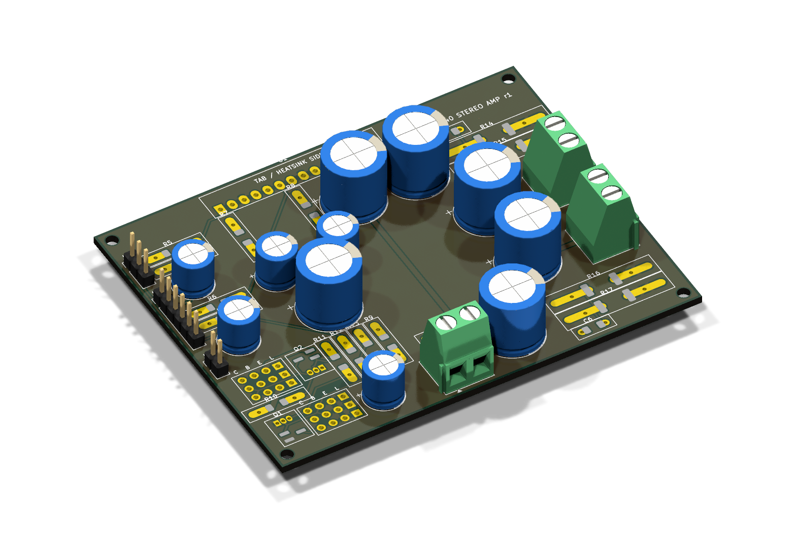
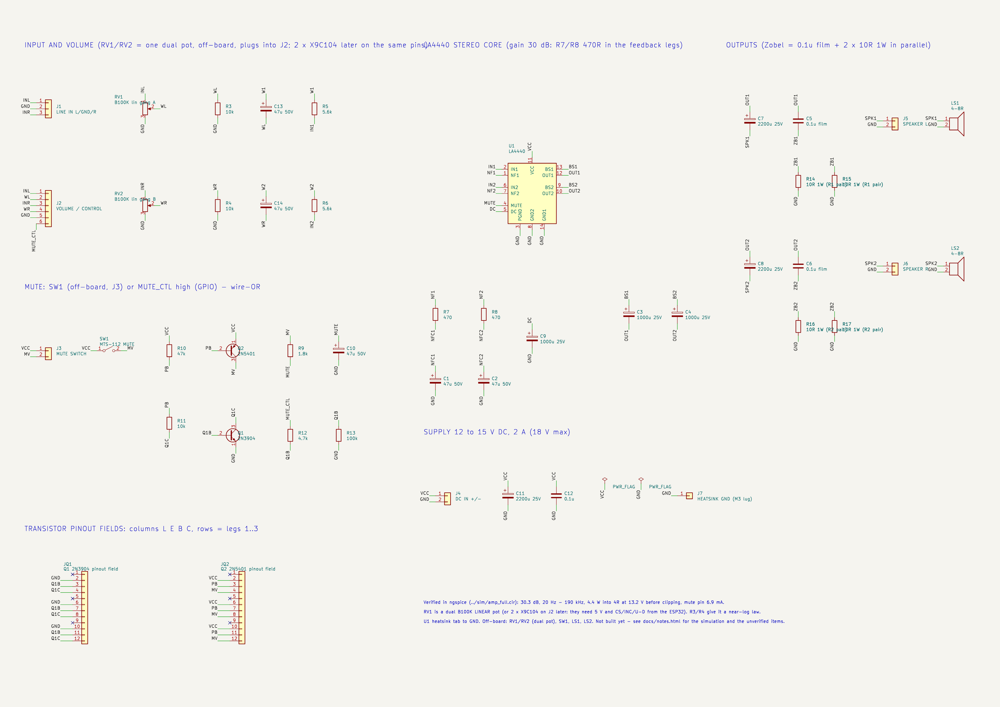
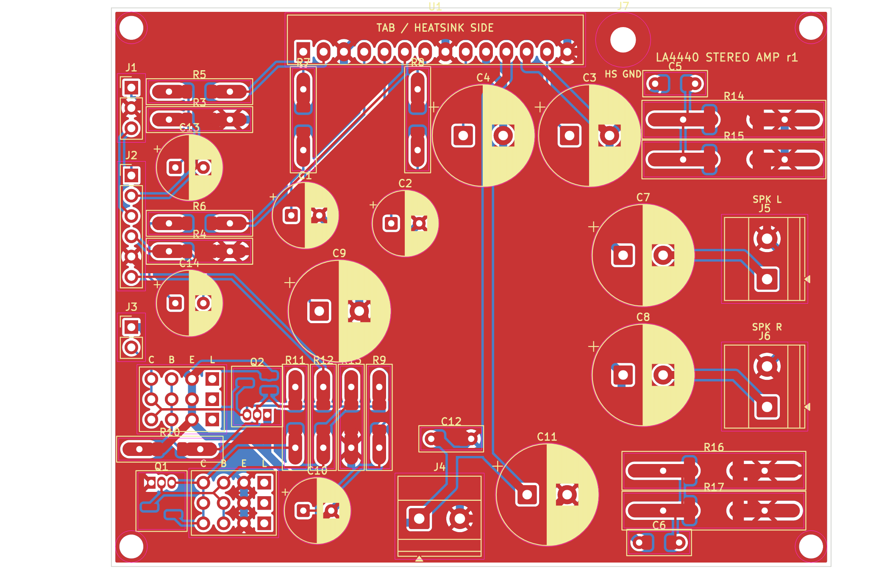
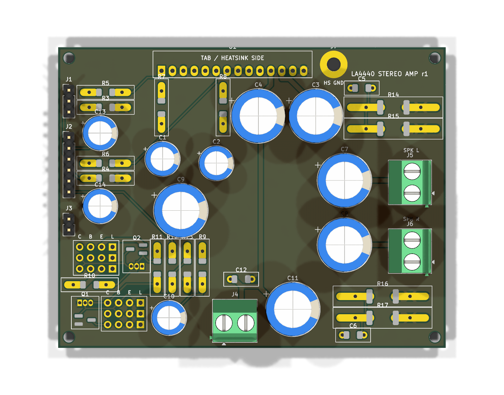

# LA4440 stereo amplifier - volume header, toggle / GPIO mute, digital-pot ready

A 2 x 4 W stereo amplifier around the Sanyo LA4440, designed from parts in a hobby bin. Volume is a dual
100k linear pot on a 6-pin header that two X9C104 digital pots can replace later without touching the
board; mute works from a panel toggle now and from a microcontroller pin later, wired in parallel.
Every number below comes from ngspice. **No board has been built or measured yet.**

| Schematic | Board (both copper layers) | 3D top |
|---|---|---|
|  |  |  |

The full design notes, with the simulation tables, findings and an interactive CircuitJS model of one
channel, are in [docs/notes.html](docs/notes.html) (download and open it in a browser).

## What it does

| | |
|---|---|
| Output | 4.4 W per channel into 4 ohm at 13.2 V at the onset of clipping (3.7 W at 12 V); the datasheet's 6 W is at 10% THD |
| Gain | 30 dB (x33), set by 470 ohm in each feedback leg. The chip alone is 51.5 dB, which would reach full power at 18 mV in and leave the volume knob useless |
| Input for full power | 0.18 V peak with the volume at maximum |
| Bandwidth | 20 Hz (2200 uF into 4 ohm) to well above 20 kHz |
| Volume | dual B100K linear pot with 10k taper resistors: -18 dB at half travel, near-log. Drop-in: 2 x X9C104 on the same header |
| Mute | LA4440 pin 4, 6.9 mA from a toggle or from a 3.3 V GPIO (2N3904 + 2N5401 high-side switch); 40 dB per datasheet, 55 dB with the 5.6k input resistors |
| Supply | 12 to 15 V DC, 2 A (18 V absolute maximum) |
| Board | 90 x 70 mm, 2 layers, GND pour both sides, 4 x M2.5 corner holes; through-hole parts with SMD twins on the same pads, transistor pinout fields |

## Repository

| Path | What |
|---|---|
| `sim/` | ngspice decks behind every number, see [sim/README.md](sim/README.md) |
| `kicad/gen_sch.py` | writes the schematic `la4440.kicad_sch` (labels, custom LA4440 symbol in `la4440.kicad_sym`) |
| `kicad/run_checks.sh` | schematic -> netlist -> `netcheck.py` against `sim/amp_full.cir` -> ERC -> PDF / PNG |
| `kicad/gen_pcb.py`, `place.py` | places the board from the netlist (hybrid footprints are written to `Custom.pretty`) |
| `kicad/build_pcb.sh` | place -> freerouting -> `post_route.py` -> GND pours -> DRC with schematic parity |
| `kicad/build_all.sh` | everything above plus 3D renders, Gerbers and the 2-up panel |
| `kicad/la4440-gerbers.zip`, `kicad/panel/` | fab files, see [ORDER_GUIDE.md](ORDER_GUIDE.md) |
| `bom.md` | parts, marked in hand / buy |
| `docs/notes.html` | design notes |

Status of the checks at the last build: netlist matches the simulation deck, ERC 0 errors, DRC 0 errors
with schematic parity (warnings left: silkscreen overlaps and the off-board parts RV1/RV2, SW1, LS1, LS2,
which have no footprint on purpose). Autorouting with freerouting is not deterministic: a rebuild can land
the tracks differently; `post_route.py` closes the one link it tends to leave open and DRC is the judge.

Tools: KiCad 9.0, ngspice 42, freerouting 1.9, KiKit 1.8. The generators need KiCad's `pcbnew` Python
module (`/usr/bin/python3` on Ubuntu).

## Building it

1. Read [bom.md](bom.md) and [ORDER_GUIDE.md](ORDER_GUIDE.md).
2. Fit everything except U1's heatsink screw. Bolt the heatsink to the LA4440 tab and wire it to J7 (GND).
3. **First power-up with the whole board populated** (the 0.1 uF + 5 ohm Zobels and the bootstrap caps are part
   of the chip's stability), no input, no speakers: bench supply at 13.2 V with a 300 mA current limit.
   Expect about 100 mA and both outputs (U1 pins 10 and 12) near 6.8 V - half the supply. Look at pins 10
   and 12 with a scope as well: a multimeter cannot see oscillation.
4. Then speakers, a quiet source, volume up slowly, and the mute toggle.

Datasheet: Sanyo LA4440 (ENN750F). Pinout used: 1 NF1, 2 IN1, 3 pre-GND, 4 mute, 5 ripple filter, 6 IN2,
7 NF2, 8 GND2, 9 BS2, 10 OUT2, 11 VCC, 12 OUT1, 13 BS1, 14 GND1 (pin 1 on the left with the marking toward
you, pins down).

## Not verified

- The mute attenuation (only the mute pin current is simulated), turn-on thump and mute pop.
- The bootstrap and the slower start from 1000 uF on pins 5, 9 and 13 (the datasheet uses 100 / 220 uF).
- Distortion and temperature. The LA4440 model is behavioural; there is no maker SPICE model.
- With 2 x X9C104 the two channels can differ by up to 2.7 dB at mid volume (+/-20% part tolerance); plan a
  per-channel offset in firmware.
- The CircuitJS link in the notes has never been opened in a browser.
- Not built, not measured.

## License

CC BY-NC-SA 4.0, see [LICENSE](LICENSE). Build it, change it, share it; do not sell it.
